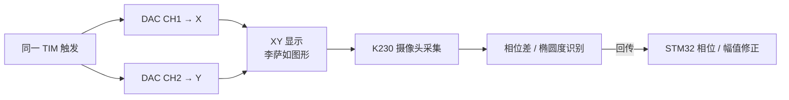

# 2026 电赛 F 题 · 李萨如图形显示控制装置

**两路同源正弦 + 一块 K230：把「相位差」变成屏幕上的直线、圆和椭圆**

[快速开始](#3-快速开始与关键实现) · [常见问题](#4-常见问题) · [全部仓库索引](https://github.com/xhtfps/xhtfps)

## 为什么要做视觉闭环

只靠开环 DAC 输出，图形「看起来对」但没法证明相位到底准不准。这里用 K230 对着屏幕采集、反解相位差再回传，形成**输出—观测—修正**的闭环，赛题要求的「显示控制」才成立。

## 亮点

- **同源同触发**：双 DAC 由同一个 TIM 触发，从根上消除相位漂移这个最常见故障。
- **相位→图形关系写清楚**：0° 直线、90° 圆、其余椭圆，答辩时不用现推。
- **幅值查表校准**：两路增益不一致会把圆压成椭圆，用同一标准源分别标定后按表补偿。
- **题、码、调研分开放**：`2026F题_网上调研/` 只放方案调研，工程目录只放实现。

## 结构

## 1. 目录一览

| 目录/文件 | 内容 |
| --- | --- |
| `F题_李萨如控制装置_F407/` | F407 主控固件：DDS 双通道输出、相位/幅值控制、按键与显示 |
| `k230/` | K230 视觉脚本：识别图形相位差、椭圆度并回传 |
| `2026F题_网上调研/` | 赛题解读与方案调研 |
| `F题_李萨如图形显示控制装置.pdf` | 赛题原文 |
| `_题目提取.txt` | 赛题要点摘录 |

## 2. 环境

| 项 | 要求 |
| --- | --- |
| 主控 | STM32F407ZGT6（Keil MDK 5.36+） |
| 信号源 | 双通道 DAC（或 AD9959）同步输出，X/Y 正交 |
| 视觉 | CanMV-K230 板 + 摄像头，MicroPython |
| 调试 | J-Link / ST-Link，USART1 115200 |

## 3. 快速开始与关键实现

1. 开 `F题_李萨如控制装置_F407` 工程，全编译 0 error 后烧录。
2. 串口确认两路波形：相位差 0°→直线、90°→圆、其余→椭圆；先固定 90° 验证链路。
3. K230 端跑 `k230/` 脚本，对准屏幕采集，回传识别出的相位差。
4. 关键点：双通道必须**同源同触发**（同一 TIM 触发双 DAC），否则相位会漂；幅值用查表校准，避免两路增益不一致把圆变成椭圆。
5. 相位步进分辨率决定图形精度，100 kHz 以内建议 ≥ 0.1°。

## 4. 常见问题

- **图形抖动/相位漂**：两路未同源触发，或 DAC 更新时刻不对齐。
- **圆变成扁椭圆**：X/Y 通道增益不匹配，用同一幅值标准源分别标定。
- **K230 识别偏差大**：镜头斜拍或屏幕反光，先正对采集并固定曝光。
- **高频率下波形失真**：DAC 采样点不足，提高 TIM 触发频率或降输出频率。

## 5. 维护说明

- 编译产物不入库，排除明细见 [`EXCLUDED_FILES.md`](EXCLUDED_FILES.md)。
- 赛题原文与调研资料版权归原作者，仅作参赛学习。
- 本仓库与 `electronics-competition` 的分工：本仓库是 F 题单一项目的完整工程，后者是历年电赛资料汇总。
## 路线图

- [x] 双通道同源触发与相位/幅值控制跑通
- [x] K230 侧识别脚本与赛题调研入库
- [ ] 补相位精度实测数据（不同频率点的误差表）
- [ ] 把识别回传改成闭环自动校正演示

## 参与与反馈

- 遇到问题请走 [Issue 模板](.github/ISSUE_TEMPLATE)，注明输出频率与观察到的图形。
- 提 PR 前先读 [CONTRIBUTING.md](CONTRIBUTING.md)；安全问题按 [SECURITY.md](SECURITY.md) 私下反馈。
- 如果这个仓库帮你省过时间，点个 ⭐ 是最省事的支持。

## 许可证

本仓自写代码见 [LICENSE](LICENSE)；赛题原文、调研资料与第三方库版权归原作者，仅作参赛学习。
